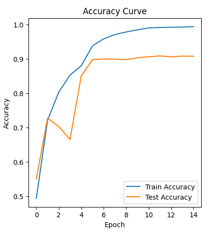
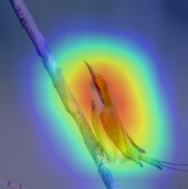

This project is a deep CNN with residual connections that sorts bird images into 10 species. It reaches 90.72% validation accuracy, up from 60.13% for the baseline model, an improvement of about 30 percentage points (1.51x).

Compound scaling laws, data augmentation, dropout and StepLR scheduling account for the gain. Class activation maps (CAM) show which parts of an image drive each prediction. The work was Assignment 3.1 of the COL333 course at IIT Delhi.

## Model

The network follows a ResNet-style layout. A 7x7 convolution with stride 2, batch normalization and a 3x3 max pool take a 300x300 image down to 64 channels at 75x75.

Eight residual blocks follow, two per stage, and grow the channels from 64 to 128, 256 and 512. Adaptive average pooling and one linear layer then map the 512 features to the 10 classes.

## Training

The labelled images are split 80% for training and 20% for validation. Training runs for 15 epochs with Adam, a learning rate of 1e-4 and batches of 64. StepLR cuts the learning rate by 10x every 5 epochs.

Augmentation adds random horizontal flips, rotations of up to 15 degrees, color jitter, and random shear and scaling.

## Results

| Technique | Validation accuracy |
| --- | --- |
| No optimization (baseline) | 60.13% |
| Compound scaling laws | 81.78% |
| Data augmentation | 89.98% |
| Dropout | 86.50% |
| StepLR, all combined | 90.72% |

Dropout made learning slower but kept performance steady. Combining all the techniques with StepLR gave the best accuracy.

## Class activation maps

Grad-CAM heatmaps show the image regions that most influence a prediction. On correct predictions the heat sits on the bird and its textures. On misclassified images the attention is scattered, which shows where the model can still improve.

