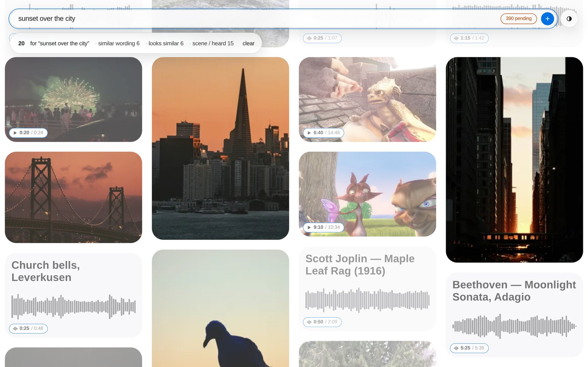
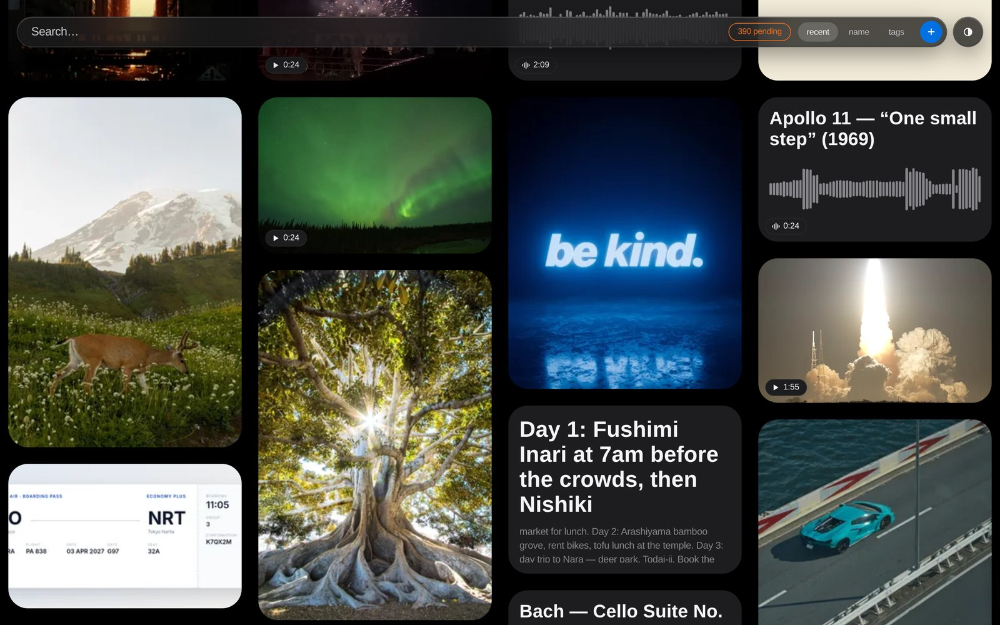

ZetaDB is my local search for everything I save: screenshots, photos, notes, recordings and video. One model, EmbeddingGemma 2, puts pictures, text, sound and video in the same space, so I can describe what I remember and it finds it in whatever form I saved it.

## Moments in audio and video

It finds the moment inside long media. Audio is embedded in 30-second windows every 25 seconds, skipping windows quieter than −50 dBFS, and video in 10-second scenes of 5 frames plus the soundtrack.

In the demo library, "why we go to the moon" opens a 17-minute speech at 8:20, where it's said. "a dragon" opens a 15-minute film at 5:20, where it flies.

## Reading images

It also reads what's in images. PP-OCRv6 pulls the text out of screenshots, receipts and whiteboards, LFM3-VL 2B writes a plain description of each image, and Needle extracts people, dates, links and to-dos from notes. "what did I spend at the cafe" finds the receipt and knows it came to \$35.65.

Images get tags from Eye, an image tagger from Desert Ant Labs, used with permission. Each tag has its own calibration curve. Confident tags are applied, unsure ones wait for a quick yes or no, and a tag I set myself is never overwritten.

## Search

Search runs several retrievers and merges them with reciprocal rank fusion. Each one ranks the items its own way, and the merge rewards items that rank well in more than one list.

| Retriever | Weight |
| --- | --- |
| Tags | 1.30 |
| Keywords (SQLite FTS5) | 1.00 |
| Meaning of the item | 1.00 |
| Visual similarity | 0.90 |

The constant is k = 60, the standard value. On top of that, moments inside audio and video have their own retriever.

Results fade back by how well they match, and every item shows what it's close to, so I can follow links across months of saved things.

## Storage and interface

Everything is stored in one SQLite file, with sqlite-vec for the vectors and FTS5 for keywords. The backend is FastAPI and the interface is Svelte.

## Fitting a 6 GB GPU

It's built to fit a 6 GB laptop GPU. Models run on TensorRT FP16 where they can, then CUDA, then CPU. The GPU work is split into two pools that are never loaded at the same time, and the text side of EmbeddingGemma 2 runs on the CPU, so a search never waits for the GPU.

| Model | Time | GPU memory |
| --- | --- | --- |
| Eye tags | 34.8 ms per image | 560 MB |
| PP-OCR text | 0.248 s per image | 414 MB |
| EmbeddingGemma 2 encoders | 1.03 s per image | 1070 MB |
| LFM3-VL 2B captions | ~2.0 s per image | 2020 MB |

During ingest a second copy of the EmbeddingGemma 2 text side runs on the GPU. OCR on TensorRT FP16 returns the same text as fp32 on 28 of 28 lines.

| Task | GPU | CPU | Speedup |
| --- | --- | --- | --- |
| PP-OCR, per image, TensorRT FP16 | 0.16 s | 1.72 s | 10.8x |
| EmbeddingGemma 2, one 30 s audio window | 0.13 s | 0.79 s | 6.1x |
| EmbeddingGemma 2, 32 text passages | 0.19 s | 2.3 s | 12.1x |

Ingesting a file peaks at 2.2 GB on the card, against 4.0 GB with Qwen3.5-4B as the captioner. The demo library of 16 photos, 10 documents, 12 notes, 12 recordings and 11 videos is searchable in about five minutes. Every model runs on my machine and nothing is uploaded.
