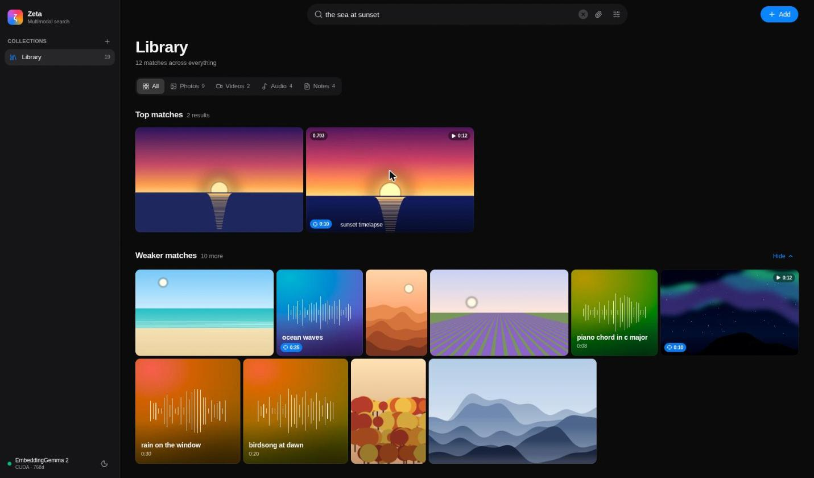

Zeta searches everything on my computer in one go: photos, videos, music, recordings, notes and code. You just describe what you want. Type "the sea at sunset" and it brings back the photo, the timelapse and the recording of the waves.

It started in 2025 as a CLIP and LanceDB project for text-to-image search. In November 2026 I rebuilt it around EmbeddingGemma 2, one model that understands pictures, sound, video and text in the same space.

It doesn't stop at the file. It points to 0:10 in the video where the sun meets the water, 0:25 in the recording where the waves roll in, or the exact paragraph in a long document. You can also search with a file: drop in a photo or a song to find similar ones, or mix a picture with a few words.

Everything runs locally. The model, the index and the files stay on the machine, and after a one-time model download it works offline.

Every file is split into segments, and each segment gets its own vector:

| Kind | How it's split |
| --- | --- |
| Text and code | ~1,800-character chunks with 200 characters of overlap, each titled with its heading, path or filename |
| Audio | 30 s windows every 25 s, silence skipped |
| Video | 10 s windows of 5 frames, plus the soundtrack as audio windows |
| Images | decoded at up to 1,024 px, 280-token default budget |

The audio windows matter a lot. EmbeddingGemma 2 only hears the first 30 seconds of an audio input, so without them the rest of a song or podcast would be invisible!

Search combines vector search over segments with LanceDB full-text search over names and text. One problem is that text scores higher than images or audio for the same topic, so with raw scores notes would crowd out photos. Each score is turned into a per-modality z-score first, which keeps results fair across kinds of media. Files are then ranked by their best segment.

Ingestion is tuned for a 6 GB laptop GPU. Files are read and segmented in parallel while the model embeds the current batch. An out-of-memory error halves the batch and retries, and a corrupt file is found by bisection so only that file fails.

| Kind (segments per second) | Batch 1 | Best batch |
| --- | --- | --- |
| Text chunks | 45 | 95 (batch 8) |
| Audio windows | 17 | 40 (batch 4) |
| Images | 9.2 | no gain from batching |
| Video windows | 3.4 | no gain from batching |

On 129 mixed files (48 photos, 64 notes, 12 audio, 4 video), indexing takes 8.8 s with the tuned defaults and 5.9 s with a smaller image budget. The same set takes about 5 minutes on CPU.

The backend is Python with FastAPI and LanceDB. The interface is React with Tailwind and shadcn/ui, with a justified photo grid, videos that play on hover, light and dark modes and a ⌘K palette.
