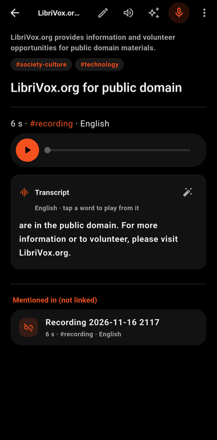
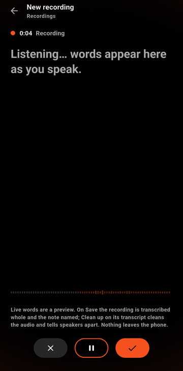
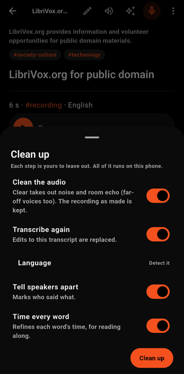
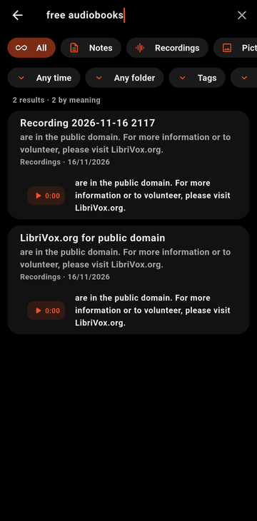

Docket is a notes app for Android where every model runs on the phone. I talk, and it writes the words down live, then transcribes the recording, detects the language, gives the note a title and tags, and keeps the audio inside the note. Tapping a word plays the recording from that point.

Notes are plain Markdown files with Obsidian's conventions: `[[links]]`, `#tags`, embeds, callouts, tasks, properties, daily notes, backlinks and a graph. They live in a folder on the phone, and I can add other folders, such as an Obsidian vault, and switch between them.

## Speech pipeline

The speech pipeline is a chain of small models. Ear identifies the language first. Phonon-2.5, the recognizer, knows 25 European languages and cannot tell which one it hears, so a recording in any other language goes to Android's own on-device recognizer (Android 13 and later).

Clean up runs Clear to remove noise and room echo, Who to tell speakers apart, and Align to time every word, each step optional.

The transcript lands in the note as editable Markdown, one paragraph per speaker turn. The word times live in a side file next to the audio, so a corrected word still lights up when it is spoken.

## Titles and tags

Titles and tags come from more on-device models. Title, a fine-tuned Granite 4.0 350M, writes a title and a short description in 1.6 to 3.3 s. Gist picks topic tags from a set of 36 in 15 to 40 ms. Eye looks at a picture and tags its note as a receipt, a whiteboard, a screenshot or a chart.

## Language models on the phone

Before settling on these I tested small Liquid AI language models on the phone for summaries and titles:

| Model | Size | Result |
|---|---|---|
| LFM3 1.7B | 1.05 GB | Good summaries, first answer in 14.7 s with loading, but not every phone can run it |
| LFM2.5 1.2B | 0.70 GB | Changed facts, such as a flight time from 7:40 to 6:40 |
| LFM2.5 350M and 230M | 0.22 and 0.15 GB | Invented content |

So Docket runs no general language model on the phone. Summarise and Tidy up go to an AI server I choose, such as llama-server or Ollama, and only when I ask.

## Search

Search mixes keywords and meaning. EmbeddingGemma 2 embeds passages of notes, transcripts and pictures, and the vectors are stored as int8, a quarter of the size with practically the same ranking. Transcript passages remember where they start, so a hit plays the recording from that moment.

Mirage adds the objects and text it finds in a picture as hidden search terms. The keyword and meaning rankings are merged by reciprocal rank with k = 60.

For example, "free audiobooks" finds a recording about LibriVox, and "present for a friend" finds a note of birthday ideas.

## Model downloads

The app ships without models. On first open it offers three downloads from Hugging Face, at pinned versions with every file checked, over Wi-Fi unless I allow mobile data:

| Download | Size | For |
|---|---|---|
| Speech-to-text | 421 MB | Transcripts, language detection, live words, Clean up |
| Text-to-speech | 71 MB | Reading notes aloud |
| Notes models | 854 MB | Titles, tags, search by meaning, picture kinds |

## Read aloud and updates

Read aloud uses Gradium's Phonon voice, one sentence at a time. The app is written in Flutter with the model bridge in Kotlin.

Once a week it checks for a new release, downloads it on Wi-Fi and installs it when I say so.
